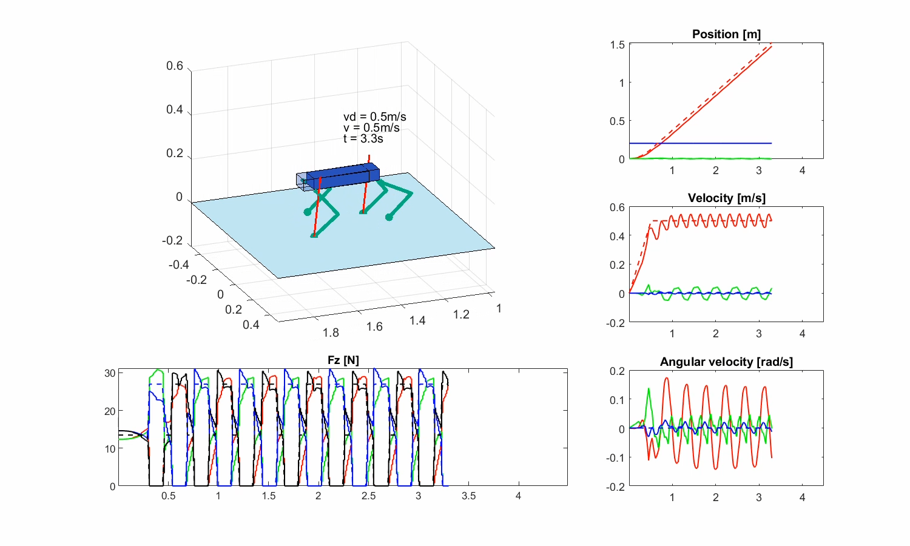
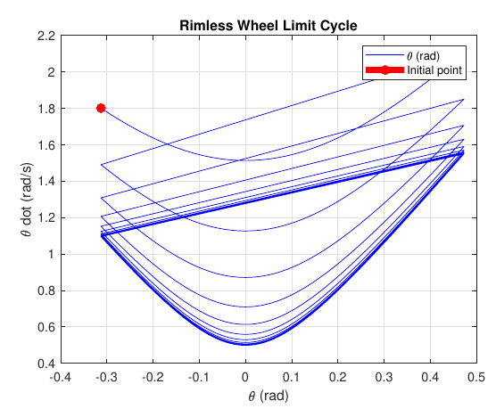

# Quadruped MPC, Rimless Wheel Dynamics and Underwater Robot Modeling

*Field and Service Robotics · University of Naples Federico II · 2024–2025*

## Overview

The report analyzes buoyancy, added mass, hydrodynamic damping, and current models for underwater robots. Two MATLAB studies explore legged locomotion using model predictive control (MPC) on a quadruped and hybrid dynamics on a passive rimless wheel.

## Approach

- The Panther simulator's MPC loop was extended with the supplied qpSWIFT solver to compute contact-force updates at each step. The animation script was extended to export comparison plots.
- The gait comparison covered trot, bound, pacing, gallop, trot-run, and crawl across changes in mass, ground friction, and target speed. The analysis examined velocity tracking, body angular motion, and vertical ground reaction forces.
- The supplied rimless-wheel simulator was used to compare initial angular velocities and changes in leg length, inter-leg angle, and slope. The analysis used time histories and phase portraits to interpret the results.

## Tools

MATLAB, qpSWIFT, and event-driven integration with `ode45`.

## Run

- **Task 3 · Quadruped.** Add the qpSWIFT MATLAB interface for the target platform to the MATLAB path. Run `MAIN` from `Task 3`. To match the trot shown below, set `gait = 0` and `p.vel_d = [0.5; 0]`. The nominal mass and friction are set in `fcns/get_params.m`. Set `p.flag_movie = 0` to turn off video recording. The summary plots are exported to `figures` with either setting. [qpSWIFT MATLAB interface](https://github.com/qpSWIFT/qpSWIFT/tree/main/matlab)
- **Task 4 · Rimless wheel.** Run `rimless_wheel` from `Task 4`. Set `thetadot0 = 1.8` to reproduce the phase portrait below.

## Key results

- Low friction degraded pacing more strongly than trot, trot-run, or crawl in the tested cases. At a **2.5 m/s** target speed, trot-run tracked the reference with regular foot contacts, while gallop lost postural stability.
- With the nominal wheel geometry and slope, the wheel came to rest from **0.95** and **−0.095 rad/s** and converged to a walking limit cycle from **1.8 rad/s**.
- Shortening the legs, reducing the inter-leg angle, and increasing the slope together produced sustained motion from **0.95 rad/s**.

## Simulation results

[Watch the 15-second nominal trot simulation (MP4)](assets/quadruped-trot.mp4)

The existing video collections cover the nominal setup and changes in friction, mass, and target speed. [Nominal setup](https://github.com/FedericoTr26/Quadruped_mpc_rimless_wheel_dynamics_underwater_robot_modeling/blob/main/videos_defaul_param.zip) · [Friction](https://github.com/FedericoTr26/Quadruped_mpc_rimless_wheel_dynamics_underwater_robot_modeling/blob/main/videos_friction_var.zip) · [Mass](https://github.com/FedericoTr26/Quadruped_mpc_rimless_wheel_dynamics_underwater_robot_modeling/blob/main/videos_mass_var.zip) · [Target speed](https://github.com/FedericoTr26/Quadruped_mpc_rimless_wheel_dynamics_underwater_robot_modeling/blob/main/videos_vel_var.zip)

The two original simulator recordings are available separately. [MP4 recording](assets/simulator-recording.mp4) · [AVI recording (7z archive)](assets/simulator-recording-avi.7z)

## Project files

- [Technical report](quadruped-mpc-rimless-wheel-dynamics-and-underwater-robot-modeling.pdf), including underwater robot modeling in Tasks 1 and 2
- [Task 3 · Quadruped MPC simulation](Task%203/MAIN.m) · [Gait parameters](Task%203/fcns/get_params.m)
- [Task 4 · Rimless-wheel simulation](Task%204/rimless_wheel.m)

The Panther simulator is based on the work of Ding et al. [Original RF-MPC repository](https://github.com/ARCaD-Lab-UM/RF-MPC) · [RF-MPC license](Task%203/LICENSE) · [Research paper](https://arxiv.org/abs/2012.10002)
